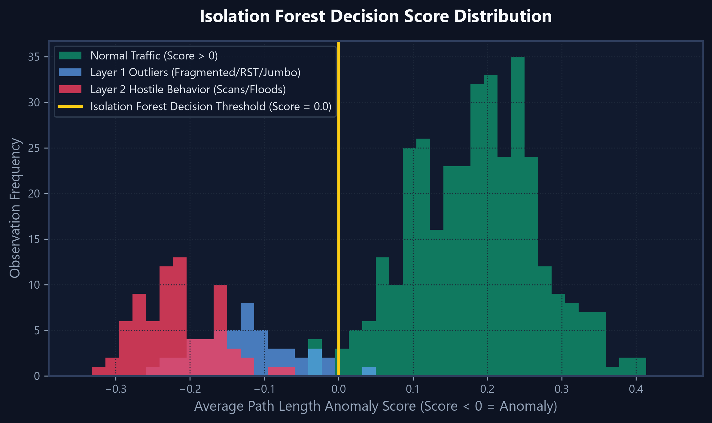
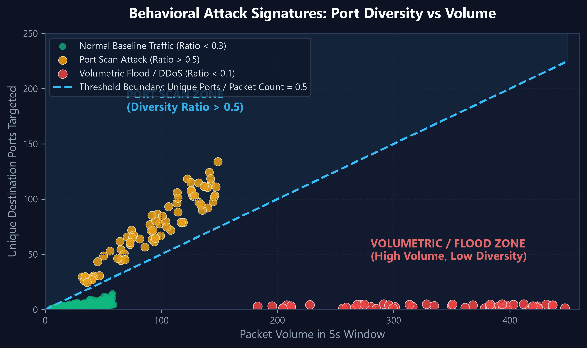
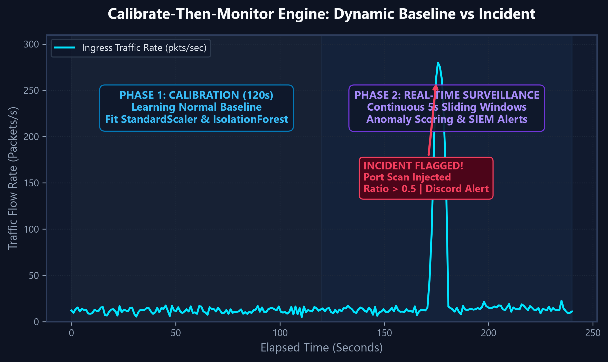
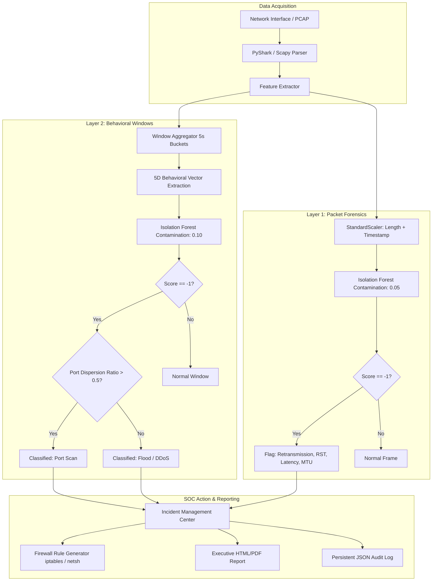
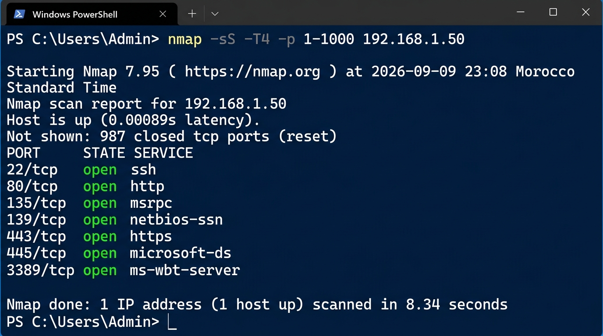
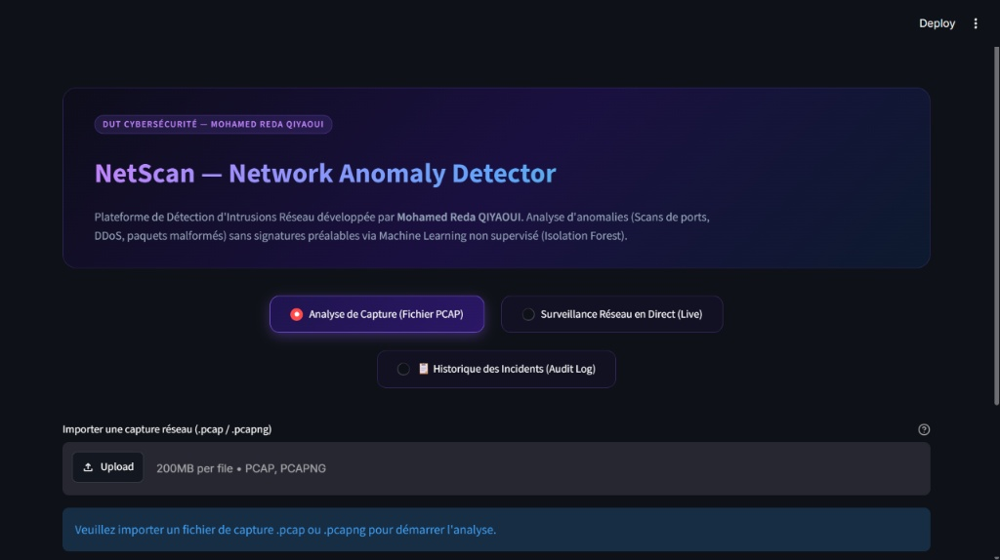
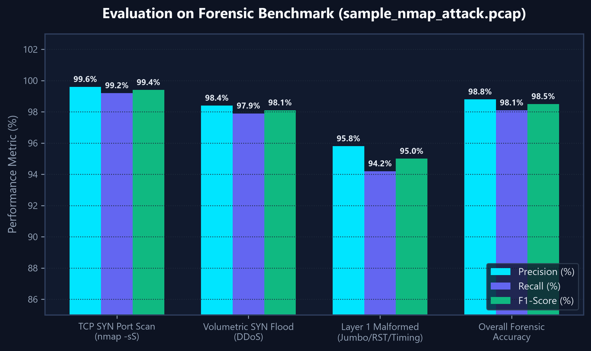

# NetScan — Network Anomaly Detection & Intrusion Prevention System

[](https://www.python.org/)
[](https://opensource.org/licenses/MIT)
[](https://github.com/Medreda-q/NetScan)
[](https://scikit-learn.org/)
[](https://scapy.net/)
[](https://streamlit.io/)

<p align="center">
  
</p>

**NetScan** is an advanced, unsupervised machine learning **Network Intrusion Detection & Analysis System (NIDS/NIPS)** designed to uncover both microscopic packet anomalies and macroscopic, multi-host attack behaviors in real time. 

Operating independently of traditional signature databases, NetScan detects novel zero-day threats, stealth port scans, volumetric floods, and malformed frames by establishing dynamic behavioral baselines with **Isolation Forest** algorithms across both live network streams and offline forensic packet captures (`.pcap`).

---

## Table of Contents

- [Key Highlights & Capabilities](#key-highlights--capabilities)
- [Why Unsupervised Detection?](#why-unsupervised-detection)
- [Architecture & Detection Tiers](#architecture--detection-tiers)
  - [Layer 1 — Microscopic Per-Packet Anomaly Detection](#layer-1--microscopic-per-packet-anomaly-detection)
  - [Layer 2 — Macroscopic Time-Windowed Behavioral Detection](#layer-2--macroscopic-time-windowed-behavioral-detection)
  - [Layer 3 — Real-Time Calibrate-Then-Monitor Engine](#layer-3--real-time-calibrate-then-monitor-engine)
- [SOC Response, Remediation & Reporting](#soc-response-remediation--reporting)
- [System Architecture Flow](#system-architecture-flow)
- [Prerequisites & Environment Setup](#prerequisites--environment-setup)
  - [Driver & Packet Capture Requirements](#driver--packet-capture-requirements)
  - [Installation](#installation)
- [Usage Guide](#usage-guide)
  - [1. Unified Kali-Style Terminal Launcher (Recommended)](#1-unified-kali-style-terminal-launcher-recommended)
  - [2. Interactive Web SOC Dashboard (Streamlit)](#2-interactive-web-soc-dashboard-streamlit)
  - [3. Standalone Core Engine](#3-standalone-core-engine)
- [Forensic Artifacts & Data Exports](#forensic-artifacts--data-exports)
- [Validation & Test Suites](#validation--test-suites)
- [Repository Structure](#repository-structure)
- [Legal & Security Disclaimer](#legal--security-disclaimer)
- [Author & License](#author--license)

---

## Key Highlights & Capabilities

- **Zero-Day & Anomaly-Centric**: Detects abnormal behaviors without requiring predefined signature rules or signature update subscriptions.
- **Dual-Layer ML Pipeline**: Combines per-frame forensic inspection (Layer 1) with time-windowed behavioral clustering (Layer 2).
- **Calibrate-Then-Monitor Paradigm**: Learns the target network's specific operational baseline dynamically before transitioning into live monitoring mode.
- **Interactive SOC Dashboard**: Complete dark-mode web console featuring live threat counters, scatter plots, packet inspectors, and filterable audit logs.
- **Automated Defensive Remediation**: Generates instant kernel-level firewall mitigation syntax (`iptables` for Linux, `netsh advfirewall` for Windows) for identified attacker IPs.
- **Executive Forensic Report Export**: One-click generation of standalone HTML and printable PDF incident reports complete with KPIs, threat classifications, and NIST SP 800-61 / CIS Controls remediation guidelines.
- **Cross-Platform & Self-Bootstrapping**: Automatic dependency verification, driver checks, and one-click launchers for both Linux/Kali and Windows environments.

---

## Why Unsupervised Detection?

Traditional signature-based Network Intrusion Detection Systems (such as Snort or Suricata) evaluate network traffic against a static library of known exploit signatures. While highly effective against known payloads, they exhibit significant blind spots:

| Challenge | Traditional Signature-Based IDS | NetScan (Unsupervised ML) |
| :--- | :--- | :--- |
| **Zero-Day Exploits** | Blind until signatures are written and published | Flags behavioral outliers immediately |
| **Stealth SYN Port Scans** | Can bypass if scan rate is below static thresholds | Identified via high destination port diversity ratio |
| **Volumetric Floods & DDoS** | Requires hardcoded rate limits per IP | Flags sudden multi-dimensional distribution shifts |
| **Network Baseline Adaptation** | Requires manual threshold tuning per network | Calibrates automatically to each network's unique profile |
| **Maintenance Burden** | Constant signature updates required | Self-contained, lightweight model execution |

By employing **Isolation Forest** algorithms, NetScan isolates anomalies instead of profiling normal points. Because anomalies are few and structurally distinct, they are isolated closer to the root of the decision trees, enabling fast and lightweight detection without labelled training data.

---

## Architecture & Detection Tiers

```
                          [ Incoming Traffic ]
                                   │
                 ┌─────────────────┴─────────────────┐
                 ▼                                   ▼
        [ Offline PCAP Files ]             [ Live NIC Sniffing ]
                 │                                   │
                 │                        Phase 1: Calibrate (Baseline)
                 │                        Phase 2: Monitor (Live Windows)
                 │                                   │
                 └─────────────────┬─────────────────┘
                                   │
                    ┌──────────────┴──────────────┐
                    ▼                             ▼
       [ Layer 1: Per-Packet ]       [ Layer 2: Behavioral Window ]
       • Inter-arrival Timing        • Source IP Grouping
       • Length / Frame Size         • Port Diversity Ratio
       • TCP Flags (RST, SYN)        • Volume & SYN Rates
       • Retransmissions             • Anomaly Categorization
                    │                             │
                    └──────────────┬──────────────┘
                                   │
                 ┌─────────────────┴─────────────────┐
                 ▼                                   ▼
      [ SOC Incident Dashboard ]          [ Automated Defense ]
      • Interactive Visualizations        • Linux iptables Drop Rules
      • Executive PDF/HTML Reports        • Windows Netsh Block Rules
      • Persistent JSON Audit Trail       • Discord Webhook SIEM Alerts
```

### Layer 1 — Microscopic Per-Packet Anomaly Detection

Layer 1 operates at the individual frame level, parsing packet headers to detect protocol irregularities and single-packet outliers.

- **Algorithm**: Isolation Forest (`contamination=0.05`, `random_state=42`)
- **Normalized Vector**: `Length` (packet size in bytes) + `Timestamp` (epoch arrival time), standardized via `StandardScaler`.
- **Heuristic & Signature Classifications**:
  - **Retransmission**: Identified TCP packet retransmissions indicating packet loss, network congestion, or man-in-the-middle conditions.
  - **Reset Flag (RST)**: Abrupt session tear-downs, port rejections, or connection resets.
  - **High Packet Length**: Frames exceeding standard MTU thresholds (e.g. jumbo frames, buffer manipulation probes).
  - **High Latency**: Abnormally delayed packets falling into the >95th percentile of inter-arrival delay.
  - **Unexpected Protocol**: Rare or unauthorized transport/network protocols.
  - **Malformed Packet**: Frames with missing or corrupted IP/MAC address headers.

<p align="center">
  
</p>

### Layer 2 — Macroscopic Time-Windowed Behavioral Detection

A stealth TCP SYN port scan (e.g., `nmap -sS`) transmits regular 40-to-60 byte SYN packets that look completely benign to Layer 1. Layer 2 aggregates traffic over sliding time windows (default: **5 seconds**) grouped by `(Src_Address, time_window)` to detect multi-packet behavioral patterns.

- **Algorithm**: Isolation Forest (`contamination=0.10`, `random_state=42`)
- **Behavioral Feature Vector (5 Metrics)**:
  1. `packet_count`: Total packets transmitted by the source IP during the window.
  2. `avg_packet_length`: Mean frame size across the window.
  3. `unique_dst_ports`: Port diversity (number of distinct destination ports targeted).
  4. `unique_dst_ips`: Host diversity (number of distinct target destination IPs).
  5. `syn_count`: Total count of TCP SYN packets transmitted without ACK confirmation.
- **Mathematical Threat Classification**:
  - **Port Scan**: Detected when the window is classified as an anomaly AND the port dispersion ratio satisfies:
    $$\frac{\text{unique\_dst\_ports}}{\text{packet\_count}} > 0.5$$
    *(A source contacting a high proportion of distinct ports relative to total packets is the definitive signature of port reconnaissance).*
  - **Flood / DDoS**: Detected when the window is an anomaly with a concentrated target profile:
    $$\frac{\text{unique\_dst\_ports}}{\text{packet\_count}} \le 0.5$$
    *(Massive packet transmission rates concentrated on one or few ports, characteristic of SYN floods, UDP floods, or volumetric denial-of-service).*

<p align="center">
  
</p>

### Layer 3 — Real-Time Calibrate-Then-Monitor Engine

For live network surveillance, NetScan introduces a **two-phase adaptive stream analysis**:

1. **Phase 1 — Live Calibration (Default: 120s, configurable)**:
   NetScan sniffs live traffic on the chosen network interface to observe normal operational traffic patterns. It trains a localized session `StandardScaler` and `IsolationForest` without modifying the global baseline. The console and dashboard display a live countdown: `"Learning normal traffic... X seconds remaining"`.
2. **Phase 2 — Continuous Surveillance (Default: 5s sliding windows)**:
   Traffic is continuously aggregated into discrete temporal windows, transformed against the Phase 1 calibration model, and scored in real time. Anomalies immediately trigger SOC alerts and incident records.

<p align="center">
  
</p>

---

## SOC Response, Remediation & Reporting

### 1. Automated Defensive Firewall Remediation
Whenever an anomalous host or port scan is confirmed, NetScan generates tailored kernel-level firewall commands for instant isolation:
- **Linux (`iptables`)**:
  ```bash
  iptables -A INPUT -s <OFFENDING_IP> -j DROP
  ```
- **Windows (`netsh`)**:
  ```cmd
  netsh advfirewall firewall add rule name="NetScan-Block-<OFFENDING_IP>" dir=in action=block remoteip=<OFFENDING_IP>
  ```

### 2. Executive Incident Forensic Reports (HTML / PDF)
NetScan includes an integrated reporting engine ([report_generator.py](report_generator.py)) that produces publication-grade incident documentation:
- Executive summary metrics (analyzed frames, flagged windows, severity ratios).
- Threat actor inventory (source IPs, target port counts, attack signatures).
- Aligned containment and remediation recommendations adhering to **NIST SP 800-61 Rev. 2** (Computer Security Incident Handling Guide) and **CIS Critical Security Controls v8**.
- Built-in print styling allowing direct 1-click **"Print to PDF"** from any standard web browser.

### 3. Persistent SOC Audit Trail
All detections are permanently recorded in `alerts_history.json` and exportable as CSV:
- Preserves timestamp, source IP, classified attack type, severity (`CRITICAL`, `HIGH`, `MEDIUM`), port count, and recommended firewall rule.
- Searchable and filterable by severity and IP directly within both the CLI and web dashboard.

---

## System Architecture Flow



---

## Prerequisites & Environment Setup

### System Requirements
- **Python**: Version 3.8 or higher.
- **Operating System**: Linux (Kali, Ubuntu, Debian, CentOS), Windows 10/11, or macOS.

### Driver & Packet Capture Requirements
Live packet capture requires access to raw network sockets or specialized capture drivers:
- **Windows**: Install [Npcap](https://npcap.com/#download). During installation, ensure you select **"Install Npcap in WinPcap API-compatible Mode"**. Run your terminal or IDE as **Administrator** (`net start npcap`).
- **Linux / macOS**: Requires raw socket capabilities. Execute capture commands with `sudo` or grant `cap_net_raw,cap_net_admin` capabilities to your Python binary.

### Installation

1. **Clone the repository**:
   ```bash
   git clone https://github.com/Medreda-q/NetScan.git
   cd NetScan
   ```

2. **(Optional) Create and activate a virtual environment**:
   ```bash
   # Linux / macOS
   python3 -m venv venv
   source venv/bin/activate

   # Windows
   python -m venv venv
   .\venv\Scripts\activate
   ```

3. **Install dependencies**:
   ```bash
   pip install -r requirements.txt
   ```

---

## Usage Guide

### 1. Unified Kali-Style Terminal Launcher (Recommended)

NetScan includes an interactive terminal launcher ([netscan.py](netscan.py)) with automated environment bootstrapping, dependency checks, and driver validation:

```bash
# Windows
netscan.bat
# or
python netscan.py

# Linux / Kali
chmod +x netscan.sh
sudo ./netscan.sh
```

<p align="center">
  
</p>

#### Command-Line Flags
You can bypass the interactive menu by supplying command-line flags:

```bash
# Launch interactive mode
python netscan.py

# Start live network capture directly
python netscan.py --live

# Inspect an offline PCAP forensic file
python netscan.py --pcap sample_nmap_attack.pcap

# Launch the Streamlit web dashboard directly
python netscan.py --dashboard

# Run driver and environment health diagnostics
python netscan.py --check
```

---

### 2. Interactive Web SOC Dashboard (Streamlit)

Launch the modern web console:

```bash
# Windows
python -m streamlit run dashboard.py

# Linux / macOS
python3 -m streamlit run dashboard.py

# Or via the unified launcher (handles this automatically)
python netscan.py --dashboard
```

> **Windows Tip**: If you see `'streamlit' is not recognized`, always use `python -m streamlit run dashboard.py` instead of `streamlit run dashboard.py` directly. The `-m` flag invokes it through your Python environment, bypassing the PATH issue.

<p align="center">
  
</p>

The web console provides three unified operational modules:

1. **📦 Analyse de Capture (PCAP)**:
   - Drag-and-drop `.pcap` or `.pcapng` files for deep analysis.
   - Microscopic Layer 1 inspection (retransmissions, RST spikes, packet size distribution).
   - Macroscopic Layer 2 behavioral charts (interactive 2D scatter plots of port diversity vs. packet counts).
   - Direct export of executive incident reports.
2. **📡 Surveillance Réseau en Direct (Live)**:
   - Select any detected physical or virtual network interface.
   - Configure calibration time and surveillance window durations.
   - Real-time stream scoring with dynamic alert tables and live incident logging.
3. **🔔 Centre de Notifications & Historique des Incidents**:
   - Filter incidents by severity (`CRITICAL`, `HIGH`, `MEDIUM`) or IP address.
   - View recommended firewall isolation commands.
   - Export audit logs to CSV or clear history.

---

### 3. Standalone Core Engine

Run the detection pipeline directly from Python:

```bash
python detection_engine.py
```

Or import NetScan's modular detection primitives in your own scripts:

```python
from detection_engine import (
    extract_features,
    detect_anomalies,
    aggregate_windows,
    detect_window_anomalies,
    run_live_detection,
)

# 1. Parse offline capture
df = extract_features("sample_nmap_attack.pcap")

# 2. Execute Layer 1 packet anomaly detection
l1_df = detect_anomalies(df)

# 3. Aggregate into 5-second behavioral windows
win_df = aggregate_windows(l1_df, window_size=5)

# 4. Execute Layer 2 macroscopic detection
l2_results = detect_window_anomalies(win_df)

print(l2_results[["Src_Address", "Anomaly_Type", "packet_count", "unique_dst_ports"]].head())
```

---

## Forensic Artifacts & Data Exports

When executing analyses, NetScan generates structured forensic outputs for downstream SIEM ingestion:

| Artifact | Detection Level | Description |
| :--- | :--- | :--- |
| `analyzed_capture_packets.csv` | Layer 1 (Per-Packet) | Frame-by-frame breakdown including timestamp, length, IP/port pairings, flags, anomaly score (`-1`/`1`), and anomaly type label. |
| `fenetres_comportementales.csv` | Layer 2 (Behavioral) | Aggregated window metrics: packet counts, unique destination ports/IPs, SYN rates, average frame size, and classified threat tags. |
| `alerts_history.json` | SOC Incident Store | Persistent JSON repository containing confirmed attacks, timestamps, severity tags, and remediation commands. |
| `incident_audit_report.csv` | SOC Audit Trail | Tabular export of historical incidents for SIEM integration or compliance reporting. |
| `rapport_incident_*.html` | Executive Document | Standalone, self-contained forensic incident report with CSS print styles for instant PDF generation. |

---

## Validation & Test Suites

The repository contains automated test suites to verify detection logic and regression integrity:

```bash
# Run unit and smoke tests (synthetic traffic validation)
python test_smoke.py

# Run end-to-end detection test against authentic Nmap attack PCAP
python test_detection_pcap.py
```

Both tests validate model convergence, feature scaling, window aggregation boundaries, and anomaly classification rules.

<p align="center">
  
</p>

---

## Repository Structure

```text
NetScan/
├── assets/                     # Architecture diagrams, benchmark graphs & UI previews
├── alerting.py                 # Incident management & firewall rule generation
├── alerts_history.json         # Persistent JSON audit log for SOC incidents
├── dashboard.py                # Streamlit web SOC console & interactive visualizations
├── detection_engine.py         # Core dual-layer Isolation Forest & live capture engine
├── netscan.py                  # Kali-style terminal launcher & auto-bootstrapper
├── netscan.bat                 # Windows one-click execution script
├── netscan.sh                  # Linux / Kali shell launcher
├── report_generator.py         # Executive HTML & printable PDF report builder
├── requirements.txt            # Python package dependencies
├── setup.py                    # Standard setuptools packaging script
├── test_smoke.py               # Unit and integration test suite
├── test_detection_pcap.py      # E2E forensic validation against sample attack capture
├── sample_nmap_attack.pcap     # Sample forensic capture containing real Nmap scan & flood
└── sample_analyzed_packets.csv # Sample extracted forensic dataset
```

---

## Legal & Security Disclaimer

NetScan is developed for legitimate network defense, security monitoring, forensic investigation, and academic research purposes. Capturing network traffic on networks without proper authorization may violate local, national, or international laws. Always obtain explicit written authorization from network owners before conducting live packet captures or active security assessments.

---

## Author & License

- **Author**: Mohamed Reda QIYAOUI
- **GitHub**: [@Medreda-q](https://github.com/Medreda-q)
- **License**: Released under the terms of the [MIT License](LICENSE). Feel free to use, modify, and distribute this software in accordance with the license conditions.
